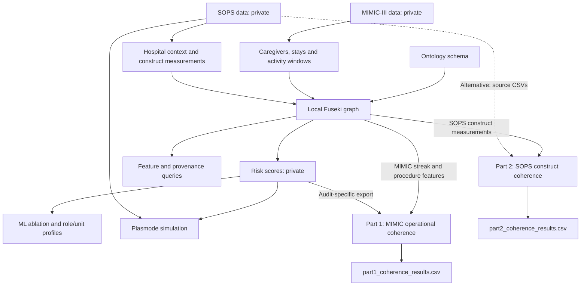

# CCKG

Code, ontology, and queries for the Clinician-Centered Knowledge Graph.

## How the files fit together

## Files and run order

| Order | Files | Purpose |
|---|---|---|
| 1 | build_cckg_schema.py; cckg-schema.owl | Define the ontology. |
| 2 | populate_mimic_step1.py; populate_mimic_step2.py | Build entities, activity windows and event aggregates. |
| 3 | convert_hsops_hospital.py | Convert the authorized HSOPS hospital SAS table to CSV. |
| 4 | populate_sops.py; build_sops_construct_measurements.py | Add hospital context and survey measurements. |
| 5 | Local Fuseki | Load the schema and generated instance files. Load only one construct-measurement file. |
| 6 | compute_wellbeing_risk.py | Calculate risk scores; load the generated risk graph into Fuseki. |
| 7 | cckg_mllo_feature_retrieval.sparql | Retrieve features and provenance. Run each query section separately. |
| 8 | part1_coherence_audit.py | Test within-caregiver relationships among MIMIC operational measures using the earlier step8_risk_scores.csv and additional graph features; write part1_coherence_results.csv for Table III. |
| 8 | part2_coherence_audit.py | Compute hospital-level SOPS construct correlations from the graph or source CSVs; write part2_coherence_results.csv (Table II). |
| 8 | cckg_part2_audit_queries.sparql | Query the Part 2 audit register for proxy-mapping verdicts; separate from the coefficient calculation. |
| 9 | ml_ablation.py; risk_profile_by_role_unit.py | Run ML analyses and summarize risk by role and unit. |
| 10 | plasmode_simulation.py | Test the modeled relationships through simulation. |

## Running the code

For data privacy, source datasets and data-derived files are not included in this repository. Some input files required to run the code are therefore unavailable here. Private data paths are also omitted from the Python scripts. Use authorized data and configure its location only in your local copy. Install the dependencies listed in requirements.txt before running the scripts.
